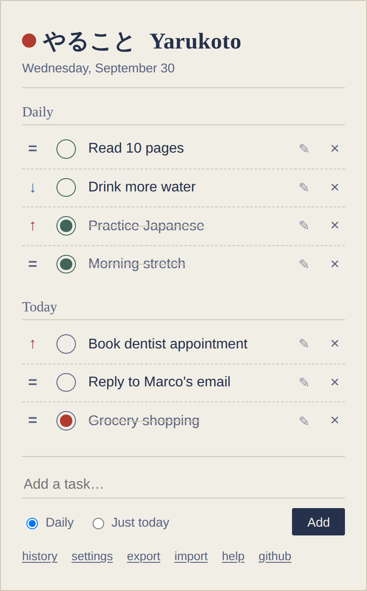

# Yarukoto (やること)

A small local-first daily task tracker. No account, no server, no sync: everything lives in your browser's local storage.

"Yarukoto" is Japanese for "things to do."

**Live:** [yarukoto.nextmiracle.eu](https://yarukoto.nextmiracle.eu/)



## How it works

- **Daily** tasks are habits: they reappear every day and reset to unchecked at midnight by default, or at a time you choose in settings. A history view shows the past seven days per habit and lists one-off tasks completed before today.
- **Today** tasks are one-off: if you don't finish one, it just stays on the list until you do, nothing is lost. 
- **Activity**: a footer entry opens a dialog with month and year views of your daily habits. The month view is a Monday-first calendar; the year view is a continuous week grid on desktop, and a 12-row month heatmap with a `Months` / `Weeks` switch on phones. Today gets a ring. Step with the previous and next arrows, and filter to one habit to see its done and not-done days, or all tasks for overall consistency. Hover a square for the exact date and which habits you completed.
- **Priority**: click the small marker next to a task and pick `↑` High, `=` Normal or `↓` Low. Tasks sort by priority within their list.
- **Local only**: no backend, no accounts, nothing sent anywhere. Data stays in your browser via `localStorage`.
- **Export / import**: back up your data to a JSON file, or restore from one.
- **Dark mode**: follows your OS/browser color-scheme preference automatically.

## Running it

No build step and no runtime dependencies. Either:

- Open `index.html` directly in a browser, or
- Serve the folder locally, e.g. `python3 -m http.server`, then visit `http://localhost:8000`

## Testing

The test suite boots the real `index.html` and `app.js` in jsdom, so no browser is needed. Install the dev dependencies once, then run the tests:

```sh
npm install   # dev dependencies only
npm test
```

CI runs the suite on pushes to `main` and on pull requests.

## Stack

Plain HTML, CSS, and JavaScript. No framework, no bundler. jsdom and Vitest are dev-only, for tests.

## About this project

The idea and design decisions are mine. The code was written almost entirely by LLMs.

## License

MIT: see [LICENSE](LICENSE).
